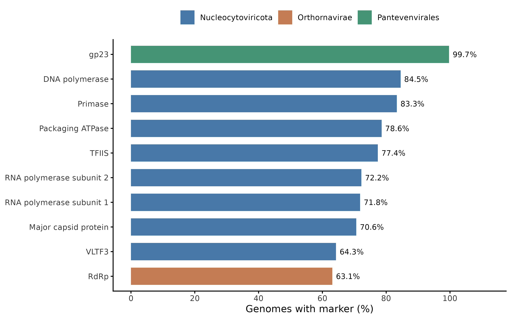
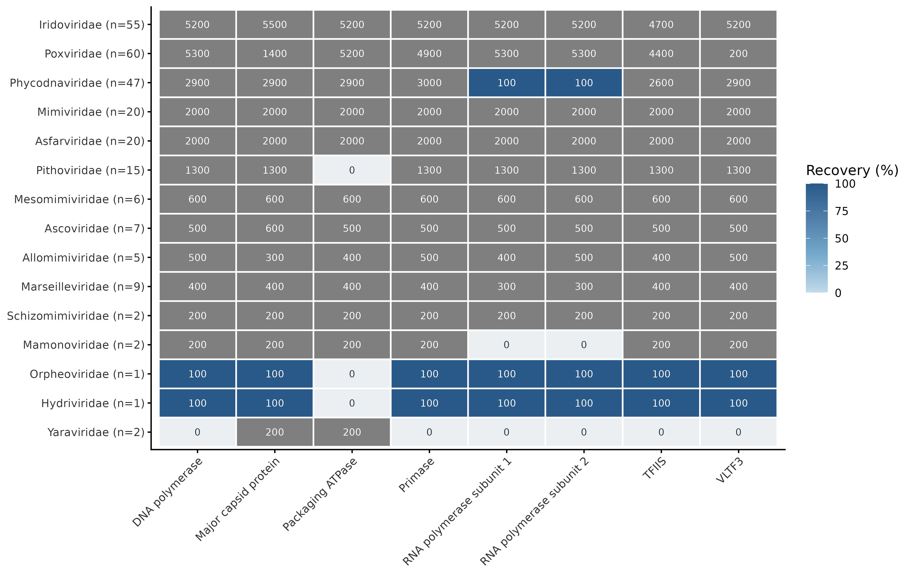
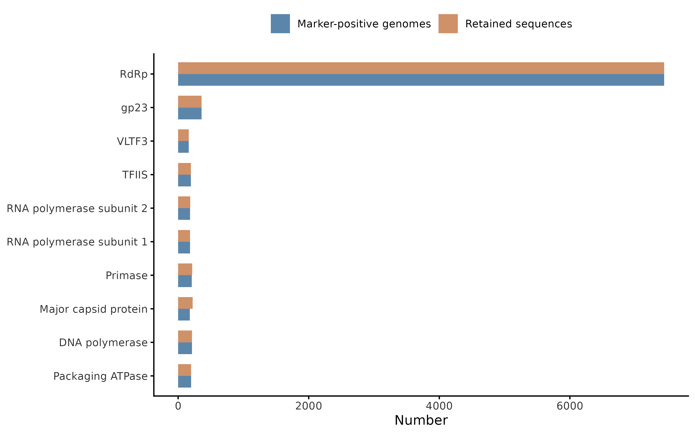
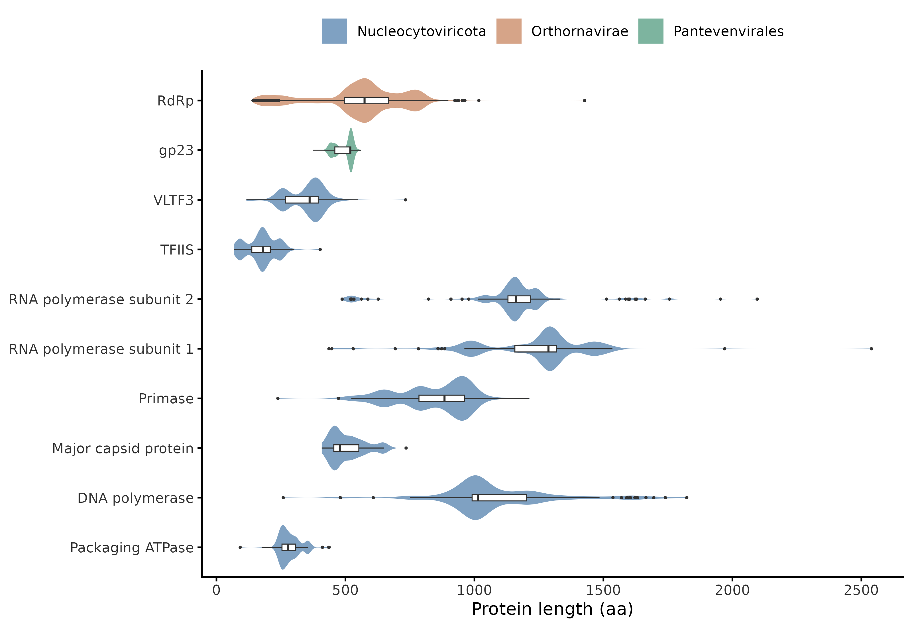
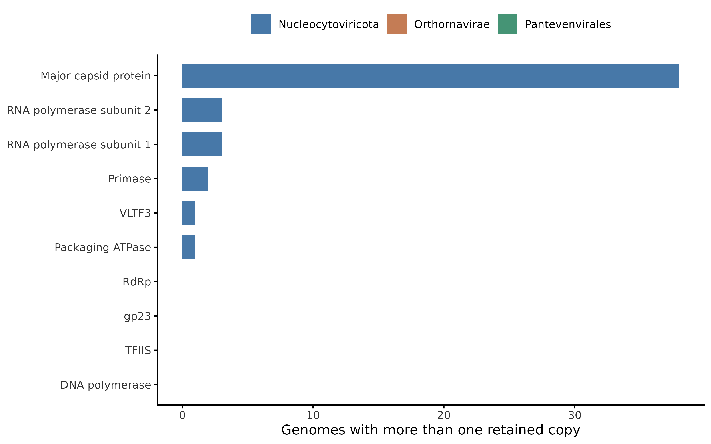
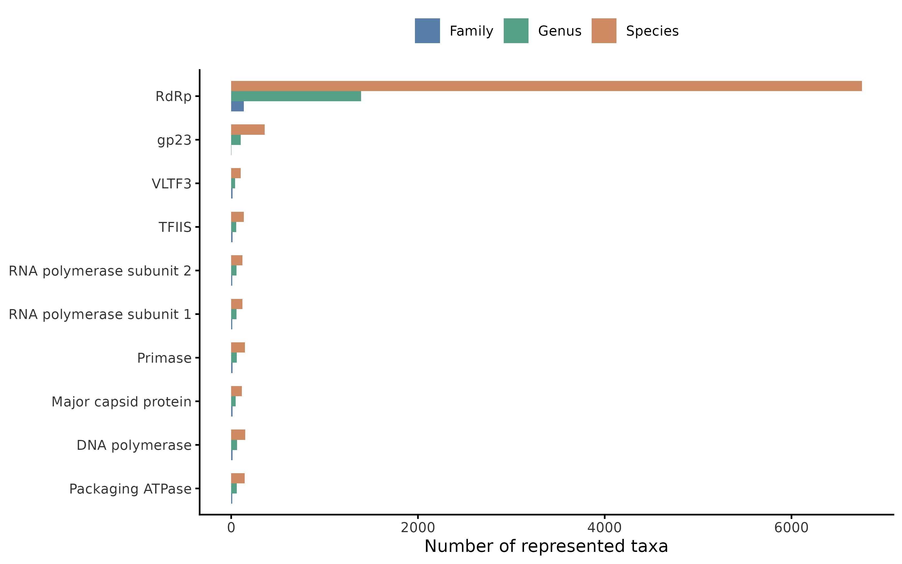
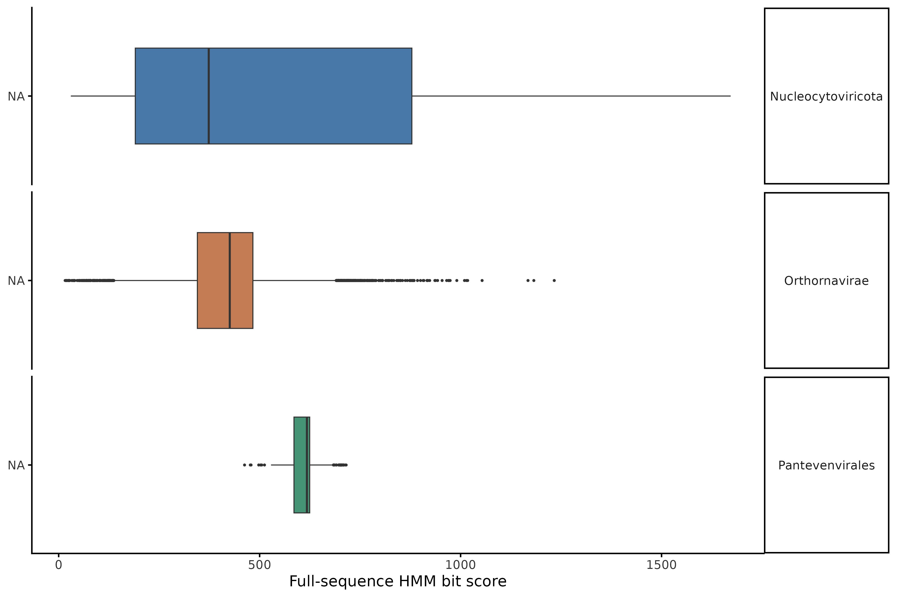
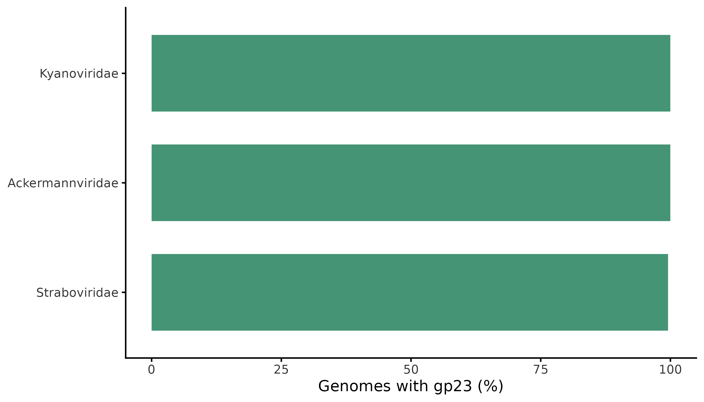
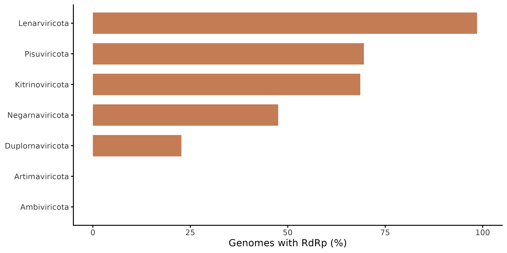

```{r}
#| echo: false
#| include: false
source("stats.R")
```


This page summarizes the taxonomic coverage, marker distribution and reference sequence composition of the current VirMarkDB release.

VirMarkDB currently integrates curated marker-gene references from three viral groups with distinct marker strategies:

- *Nucleocytoviricota*, represented by eight conserved marker genes used for multi-marker characterization;
- *Pantevenvirales*, represented by the phage capsid marker g23;
- *Orthornavirae*, represented by the RNA-dependent RNA polymerase (RdRp) marker.

For database construction and workflow details, see [Database](database.qmd) and [Workflow](workflow.qmd).

# Release summary

The current genome and taxonomic counts are generated from the processing manifest by `scripts/assessment/13_summary_satistics.R` and stored in `data/analysis/summary/`. Marker recovery describes detection and retention under the current pipeline settings, not confirmed biological absence.

| Group | Genomes | Families |
|---|---:|---:|
| Nucleocytoviricota | `r database_stat("Nucleocytoviricota", "genomes")` | `r database_stat("Nucleocytoviricota", "families")` |
| Pantevenvirales | `r database_stat("Pantevenvirales", "genomes")` | `r database_stat("Pantevenvirales", "families")` |
| Orthornavirae | `r database_stat("Orthornavirae", "genomes")` | `r database_stat("Orthornavirae", "families")` |

*Values are read directly from `scope_summary.tsv` when the website is rendered. Regenerate this file after rebuilding VirMarkDB.*

# Nucleocytoviricota marker coverage

*Nucleocytoviricota* genomes are represented using eight conserved marker genes selected for their phylogenetic and taxonomic relevance.

## Marker distribution across genomes



## Marker distribution across families



## Marker sequence characteristics







## Taxonomic representation



## HMM hit scores



The full-sequence bit scores describe retained HMMER matches; they should not be interpreted as a direct comparison of marker quality across HMM profiles.

# Pantevenvirales marker coverage

*Pantevenvirales* representatives are characterized using the g23 major capsid protein marker.



# Orthornavirae marker coverage

RNA viruses are represented through the RNA-dependent RNA polymerase (RdRp) marker, detected using RdRp-scan profiles.




# Notes and limitations

Absence of a marker gene in VirMarkDB should not automatically be interpreted as a biological absence.

Missing marker sequences can result from incomplete genomes, marker divergence, ORF prediction limitations, annotation errors or filtering thresholds.