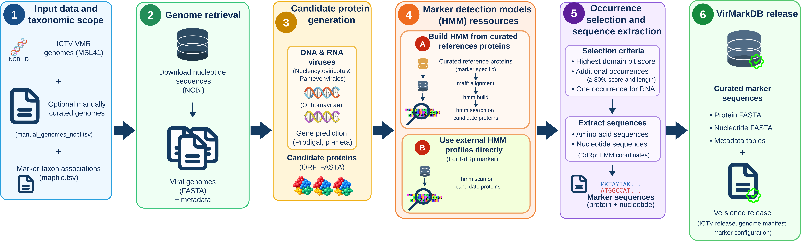
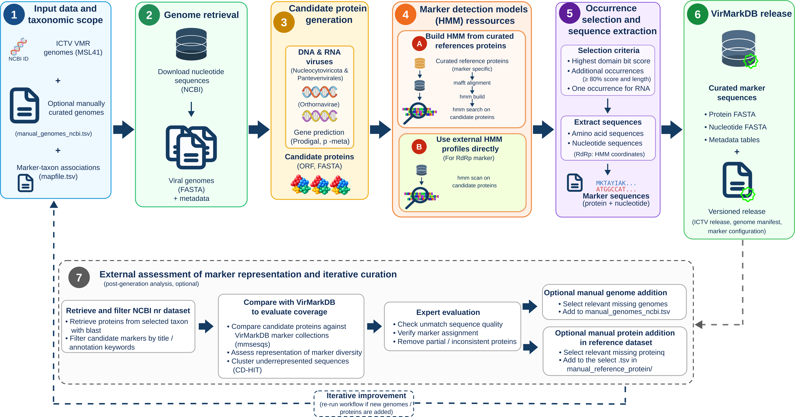

VirMarkDB documents how the database is generated, how marker-specific HMM profiles are built and applied, and how the database is refined through assessment-guided detection of missing or underrepresented diversity. The same overall workflow framework is used for the three viral groups currently covered (giant viruses, phages, and RNA viruses) with marker-specific search strategies. Each genome is searched only against the marker profiles relevant to its taxonomic scope.

::: {.callout-note}
The workflow is organized by taxonomic scope using `mapfile.tsv`. The Nucleocytoviricota and Pantevenvirales markers use locally built profiles with `hmmsearch`, whereas RdRp candidates are screened using the external RdRp-scan profiles with `hmmscan`. The diagram above should be interpreted per scope, rather than as a single search against all markers.
:::

## Input and provenance

### ICTV resources

The initial genome manifest and taxonomy come from the ICTV Virus Metadata Resource [VMR_MSL41.v1.20260320](https://ictv.global/sites/default/files/VMR/VMR_MSL41.v1.20260320.xlsx) (released 2026-03-20), providing virus names, ICTV identifiers, full taxonomy, GenBank accessions, genome composition, and host-source metadata.

### Additional genome inputs

Manually added genomes (not yet covered by the ICTV VMR) are listed in `input/manual_genomes_ncbi.tsv` and merged using the same taxonomy fields.

Show <code>input/manual_genomes_ncbi.tsv</code> (excerpt)

| virus_id | Family | Genus | Species | Source | Virus_names_abrv | Host_source |
|---|---|---|---|---|---|---|---|
| NC_075136 | Allomimiviridae | Oceanusvirus | O. kaneohense | MANUAL_NCBI | TsV1 | algae |
| PP728251 | Phycodnaviridae | Prasinovirus | P. micromonas polaris | MANUAL_NCBI | MpoV-46T | algae |
| NC_076895 | Yaraviridae | Yaravirus | Y. brasiliensis | MANUAL_NCBI | BHMG | protists |

### Marker-group configuration

`input/mapfile.tsv` is the single source of truth for which marker genes are processed against which taxonomic scopes. Each row defines one **marker group**: a marker gene, a taxonomic scope, a reference protein set, and its associated HMM resource (built locally or obtained from RdRp-scan). The pipeline uses this file at every stage: reference preparation, HMM construction, and HMM search. So each genome is only searched against the profiles relevant to its taxonomic scope.

Show <code>input/mapfile.tsv</code>

| group_id | taxo_rank | taxo_value | marker | marker_group_id | manual_file |
|---|---|---|---|---|---|
| nucleocytoviricota | Phylum | Nucleocytoviricota | majorcapsid | majorcapsid_nucleocytoviricota | majorcapsid_nucleocytoviricota.tsv |
| nucleocytoviricota | Phylum | Nucleocytoviricota | dnapol | dnapol_nucleocytoviricota | dnapol_nucleocytoviricota.tsv |
| nucleocytoviricota | Phylum | Nucleocytoviricota | atpase | atpase_nucleocytoviricota | atpase_nucleocytoviricota.tsv |
| nucleocytoviricota | Phylum | Nucleocytoviricota | primase | primase_nucleocytoviricota | primase_nucleocytoviricota.tsv |
| nucleocytoviricota | Phylum | Nucleocytoviricota | rnapol1 | rnapol1_nucleocytoviricota | rnapol1_nucleocytoviricota.tsv |
| nucleocytoviricota | Phylum | Nucleocytoviricota | rnapol2 | rnapol2_nucleocytoviricota | rnapol2_nucleocytoviricota.tsv |
| nucleocytoviricota | Phylum | Nucleocytoviricota | tf2s | tf2s_nucleocytoviricota | tf2s_nucleocytoviricota.tsv |
| nucleocytoviricota | Phylum | Nucleocytoviricota | vltf3 | vltf3_nucleocytoviricota | vltf3_nucleocytoviricota.tsv |
| pantevenvirales | Order | Pantevenvirales | g23 | g23_pantevenvirales | gp23_pantevenvirales.tsv |
| orthornavirae | Kingdom | Orthornavirae | rdrp | rdrp_orthornavirae | rdrp_orthornavirae.tsv |

During HMM search, `genome_marker_map.tsv` resolves which genomes fall within each marker group's taxonomic scope, and therefore which profiles apply to which genome. The conceptual rationale for splitting markers this way is covered in [Database → Why marker groups exist](database.qmd#why-marker-groups-exist).

### HMM profile resources

For the eight Nucleocytoviricota markers and gp23, HMM profiles are built from marker-specific reference protein sets stored in `output/references_protein/`, sourced from three places. RdRp detection instead uses the external RdRp-scan profile database:

| Source type | Description |
|---|---|
| Published reference datasets | Initial conserved NCLDV marker-protein reference set |
| Manual curation | Added when a marker was missing or poorly represented |
| Assessment-guided additions | Added after assessment analysis to improve marker coverage |

## Pipeline

::: {.pipeline-steps}

**1 · ORF prediction**: ORFs are predicted from each genome with Prodigal in metagenomic mode (`prodigal -p meta`). Script: `02_prodigal.bash`

**2 · Alignment**: Locally prepared marker reference proteins are aligned with MAFFT (`mafft --ep 0 --genafpair --maxiterate 1000`). Script: `03_align_markers.bash`

**3 · HMM profile construction**: Local reference alignments are converted to HMM profiles with HMMER `hmmbuild`. The RdRp profiles are supplied by RdRp-scan instead. Script: `04_hmmbuild.bash`

**4 · HMM search**: Predicted ORF proteomes are searched using `hmmsearch` for the locally built marker profiles and `hmmscan` for RdRp-scan. Searches use a full-sequence E-value threshold of `1e-5` and export domain-level results (`--domtblout`). Genome-to-marker assignments come from `genome_marker_map.tsv`. Script: `05_hmmsearch.bash`

**5 · Hit selection**: For each ORF, the best HMM hit is selected by decreasing full-sequence bit score, then increasing full-sequence E-value; the domain bit score resolves ties between domain rows. ORFs are then ranked by the same full-sequence criteria within each genome × marker group. The top-ranked ORF is provisionally selected, for markers other than RdRp, additional ORFs may be retained if they meet both score and ORF-length ratios below. For RdRp, only the selected domain envelope (`env_from`–`env_to`) of the top ORF is extracted, rather than the entire predicted ORF. Finally, sequences shorter than 25% of the median exported protein length for their marker group are discarded. Script: `06_final_results.R`

| Filter | Threshold |
|---|---|
| Score ratio relative to best hit | ≥ 0.80 |
| ORF length ratio relative to best hit | ≥ 0.80 |

*The two copy-retention thresholds apply to markers other than RdRp. The final length filter applies to all markers.*

:::

## VirMarkDB assessment

VirMarkDB is assessed against broader viral protein pools extracted from a local NCBI NR database to identify marker diversity missing or underrepresented in the current release.

| Step | Description | Script |
|---|---|---|
| 1 | Extract viral protein pools from NR, split by marker via title-based filters | `07_scrap_viral_protein_ncbi.bash` |
| 2 | Self-align each marker pool to flag isolated/suspicious sequences | `08_align_pool_vs_pool.bash` |
| 3 | Analyse self-alignments, filter likely misannotated proteins | `09_results_align_pool_vs_pool.R` |
| 4 | Compare filtered pool against current VirMarkDB | `10_align_pool_VirMarkDB.bash` |
| 5 | Identify proteins not covered by the current release | `11_analyse_results_align_pool_VirMarkDB.R` |
| 6 | Cluster missing proteins with CD-HIT to reduce redundancy | `12_clusterise_missing_prot.bash` |

## Software versions

| Tool | Version |
|---|---|
| R | 4.5.2 |
| Prodigal | 2.6.3 |
| MAFFT | 7.525 |
| HMMER | 3.3.2 |
| BLAST+ | 2.16.0 |
| MMseqs2 | 15.6f452 |
| CD-HIT | 4.8.1 |